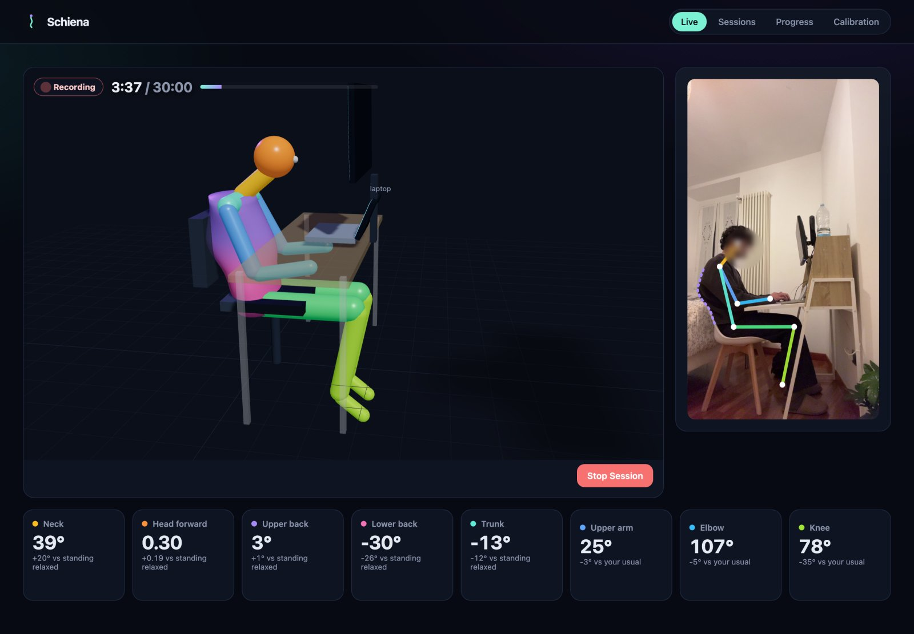

# Schiena

Schiena helps you improve how you sit at your desk. You put your phone at your side and work as usual for 30 minutes. The phone sends what its camera sees to your computer, which measures your posture once per second: neck, head position, upper and lower back, trunk, arms, knees. A dashboard on your computer shows a 3D model of you at your desk, and graphs of each measurement over the session.

You then ask Claude Code to look at the results. It writes a short report, suggests one change to try (raise the monitor, move the keyboard closer, take breaks…), and after another session tells you whether the change made a measurable difference.



Schiena is not a medical device and doesn't diagnose anything. It compares you with yourself: how you sit today against how you sat before a change.

## What you need

- A computer with macOS (tested), Linux or Windows.
- A phone with a camera and a browser on the same Wi-Fi network as the computer. Tested with an iPhone and Safari; nothing to install on the phone.
- [Claude Code](https://docs.claude.com/en/docs/claude-code/overview) with a Claude subscription. No API key is needed.
- About 1 GB of disk space for the dependencies and the pose model.

Claude installs the rest for you: [uv](https://docs.astral.sh/uv/) (Python), Node.js (to build the dashboard), the Python packages and the MediaPipe pose model.

## Setup

```sh
git clone https://github.com/PierpaoloBene/schiena.git
cd schiena
claude
```

In Claude Code, type:

```
/setup
```

Claude checks what's missing, installs it, starts Schiena and opens the dashboard in your browser at http://127.0.0.1:4700. It may ask your permission before running commands.

If you prefer to do it yourself: install uv and Node.js 20+, then run

```sh
uv run schiena setup   # downloads the model, builds the dashboard, checks everything
uv run schiena         # starts the server and opens the dashboard
```

Leave it running while you record. Stop it with Ctrl+C.

## Recording a session

1. Scan the QR code on the dashboard with your phone.
2. The phone's browser warns that the connection is not private. That's expected: the page is served by your own computer with a certificate it made itself. On iPhone tap **Show Details → visit this website**. You only do this once.
3. Tap **Start camera** and allow access to the camera.
4. Put the phone **beside you**, upright, at chest height, 1.5–2 m away, so it sees you exactly in profile. A small tripod or a stack of books works. Plugging the phone into a charger is a good idea.
5. Sit down and work. The phone tells you if the framing is wrong; when it's right, recording starts by itself and stops after 30 minutes. Keep the browser page open; the phone screen goes black to save battery.

You can stand up and leave during a session: time away from the desk is detected and left out. If the phone gets a call, the Wi-Fi drops or the page reloads, recording picks up where it stopped.

## After a session

1. On the dashboard, open the session and rate any discomfort you felt (0–10 for neck, shoulders, back, wrists, legs).
2. In Claude Code:
   - `/report` writes a report of the latest session. You can read it on the session's page.
   - `/calibrate` rebuilds your desk in 3D from the session (monitor, keyboard, chair) and measures things like the height of the monitor relative to your eyes. Run it after your first session, and again if you change your desk or move the phone.
   - `/coach` tells you what to do next.

You can also just ask in your own words ("how did I sit today?", "what should I change?").

### Calibration (optional, recommended)

On the phone page tap **Calibrate** and:

- enter your height, so distances are in real centimetres;
- take a photo standing relaxed, side-on, and one facing the camera (there's a 10-second timer so you can step back);
- add a couple of photos of your desk.

With the standing photo, Schiena can tell you how your sitting posture differs from your relaxed standing one, which is more useful than a raw angle.

## How the improvement cycle works

1. Record two normal sessions. These are your baseline, and the difference between them shows how much your posture varies on its own from day to day.
2. Claude suggests one change from a [list of interventions](docs/intervention-library.md) based on OSHA guidelines and published research.
3. Make the change and record another session.
4. The change counts as successful if a related measurement moved by more than your normal variation and your discomfort didn't get worse. If it didn't help, you undo it and try something else.

Keep the phone in the same place and record at a similar time of day, so sessions can be compared. The **Progress** page shows every change you tried and its result.

## What is measured

| Measurement | How |
|---|---|
| Neck, head forward | position of the ear relative to the shoulder |
| Upper and lower back | the outline of your back between shoulder and hip |
| Trunk | angle of the line from hip to shoulder |
| Upper arm, elbow | how far you reach for the keyboard and mouse |
| Hip, knee | when not hidden by the desk |
| Breaks, stillness | time away from the desk, longest time without moving |

A single camera can't measure angles exactly; expect errors of a few degrees, and body parts hidden by the desk are reported as not visible. That's why Schiena compares your sessions with each other instead of with ideal values.

## Privacy

- No video is saved. Schiena keeps the body measurements (one per second) and two still frames per minute, in the `data/` folder on your computer.
- The phone only talks to your computer. The address the phone uses only accepts camera frames and photos; your data can't be read from the network.
- When you run `/report` or `/calibrate`, Claude Code reads some of those frames and the measurements, like any file you show it, and they are sent to Anthropic to generate the answer. Because the phone films you from the side, your screens are seen edge-on and their content isn't readable.
- To delete a session, use the button on its page. To delete everything, delete the `data/` folder.

## Troubleshooting

| Problem | What to do |
|---|---|
| The phone can't open the page | Check that phone and computer are on the same Wi-Fi (not a guest network). On macOS, allow incoming connections for Python when asked, or in System Settings → Network → Firewall. |
| No camera prompt on iPhone | Settings → Apps → Safari → Camera → Ask. |
| The phone screen locks | Set Auto-Lock to Never while recording (needed only on iOS older than 16.4). |
| "Port already in use" | Schiena is already running, or another app uses the port: `uv run schiena --port 4800 --lan-port 4843`. |
| You don't have a phone at hand | Film yourself from the side with any camera and run `uv run schiena ingest video.mp4`. |

`uv run schiena doctor` checks the installation.

## Project layout

```
src/schiena/       the server and all measurement code (Python)
web/               the dashboard and the phone page (React, three.js)
tests/             tests for the measurement code
docs/              design notes and the intervention list
.claude/skills/    the Claude Code commands: /setup, /calibrate, /report, /coach
```

How it works in detail: [docs/design.md](docs/design.md).

## Development

```sh
uv run pytest                   # run the tests
npm --prefix web run dev        # dashboard with hot reload (with `uv run schiena` running)
uv run schiena replay video.mp4 # send a video to the running server as if it were the phone
uv run schiena --help           # all commands
```

## License

MIT
